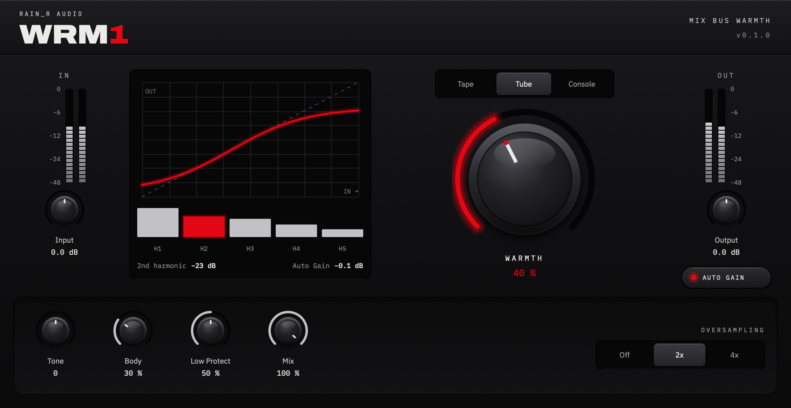

# Rainr Audio plugins

Audio plugins by Rainr Audio, built with [JUCE](https://juce.com).

| Plugin | What it does | Status |
|--------|--------------|--------|
| WRM1 | Mix-bus warmth saturator | in development |



**Testing a build?** Download it from [Releases](https://github.com/rainerb16/rainr-audio-dsp/releases)
and follow [docs/INSTALL.md](docs/INSTALL.md).

## Building on a Mac

Requires Xcode (command-line use is enough) and CMake 3.22+.

```
git clone --recurse-submodules https://github.com/rainerb16/rainr-audio-dsp.git
cd rainr-audio-dsp
cmake -S . -B build -DCMAKE_BUILD_TYPE=Release
cmake --build build --target WRM1_VST3 WRM1_AU -j8
```

Plugins land in `build/plugins/WRM1/WRM1_artefacts/Release/`. To check the UI without a DAW,
build `WRM1Snapshot` and run `build/tools/WRM1Snapshot_artefacts/Release/WRM1Snapshot out.png warmth=0.7`. Local builds are for the Mac you
are on; add `-DRAINR_UNIVERSAL=ON` for Intel + Apple Silicon.

## Docs

- [docs/INSTALL.md](docs/INSTALL.md): installing test builds (Mac, Windows, Ableton)
- [docs/WRM1_DSP.md](docs/WRM1_DSP.md): the WRM1 sound, specified
- [docs/CONVENTIONS.md](docs/CONVENTIONS.md): IDs, versions, repo layout
- [dsp-lab/README.md](dsp-lab/README.md): Python reference model and listening tools
- [CHANGELOG.md](CHANGELOG.md)
