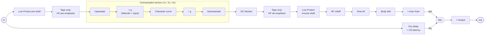

# WRM1 DSP specification

Status: **frozen for the v1 C++ port** (Phase 1 sign-off pending).
Reference implementation: `dsp-lab/wrm1.py`. Where this document and the Python disagree, the
Python wins and this document gets fixed.
Auto Gain data: `dsp-lab/autogain_table.json` (generated by `dsp-lab/calibrate.py`).

WRM1 is a mix-bus warmth saturator: mostly 2nd-harmonic colour, gentle HF rolloff, optional
low-mid body, and soft compression that comes from the curve itself (no detector, no envelope).

---

## 1. Parameters

Parameter IDs are **permanent**. Saved Ableton sets store values by ID; renaming or removing an
ID silently resets that control in every saved project. New parameters may be added; existing
ones are never renamed, re-ranged or re-ordered. Choice parameters store an **index**, so the
order of choices is permanent too (new choices go at the end).

| ID             | Name         | Range / values             | Default | Display              | Notes |
|----------------|--------------|----------------------------|---------|----------------------|-------|
| `input`        | Input        | -12 … +12 dB               | 0 dB    | dB, 0.1              | Gain staging into the curve; compensated by Auto Gain |
| `warmth`       | Warmth       | 0 … 1                      | 0.40    | 0–100 %              | Main control |
| `tone`         | Tone         | -1 … +1                    | 0       | Dark 100 … Bright 100 | Tilt |
| `body`         | Body         | 0 … 1                      | 0.30    | 0–100 %              | Low-mid bell |
| `character`    | Character    | 0 Tape, 1 Tube, 2 Console  | 1 Tube  | name                 | Order is permanent |
| `lowProtect`   | Low Protect  | 0 … 1                      | 0.50    | 0–100 %              | |
| `mix`          | Mix          | 0 … 1                      | 1.00    | 0–100 %              | |
| `autoGain`     | Auto Gain    | off / on                   | on      |                      | |
| `output`       | Output       | -12 … +12 dB               | 0 dB    | dB, 0.1              | After everything |
| `oversampling` | Oversampling | 0 Off(1x), 1 2x, 2 4x      | 1 (2x)  |                      | Not automatable; changes latency |

Bypass uses the host's bypass (JUCE `getBypassParameter`), not a custom parameter.

---

## 2. Signal flow

Per channel, identical settings on both channels (stereo-linked: no cross-channel interaction,
so a future Mid/Side mode is just an M/S encode before and decode after this chain).



`out = (1 - mix) · dry + mix · wet`, then `× db2lin(output)`.
Only the oversampled section runs at the higher rate; all filters run at the host rate.
Input trim has no gain stage of its own: it adds to `drive_dB` (2.1).

### 2.1 Drive

```
drive_dB = -4 + 18 · warmth + input          (DRIVE_MIN -4, DRIVE_MAX +14, linear in dB)
g        = 10^(drive_dB / 20)
wet      = curve(g · u) / g
```
Dividing by `g` makes the small-signal gain exactly 1 at every setting (all curves have slope 1
at 0). Turning Warmth up therefore adds colour and compression, never level. With Auto Gain off,
the plugin never jumps in level; heavy settings get slightly quieter as peaks compress.

### 2.2 Character curves

Generic biased form, for base curve `f` with derivative `f'` and bias `b`:
```
curve(u) = ( f(u + b) - f(b) ) / f'(b)
```
This keeps `curve(0) = 0` and `curve'(0) = 1`. The bias makes the curve asymmetric → even
harmonics (H2 ∝ amplitude² at low levels).

| Character | f       | bias b | HF pre/de-emphasis              | Extra HF rolloff at Warmth 1 |
|-----------|---------|--------|---------------------------------|------------------------------|
| Tape      | tanh    | 0.15   | high shelf 3 kHz, ±4 dB, S=1    | 1.5 dB                       |
| Tube      | tanh    | 0.25   | none                            | 0.5 dB                       |
| Console   | cubic   | 0.06   | none                            | 0 dB                         |

- `tanh`: `f(u) = tanh(u)`, `f'(u) = 1 - tanh²(u)`.
- `cubic`: `v = clamp(u, -1.5, 1.5)`, `f(u) = v - (4/27)·v³`, `f'(u) = 1 - (4/9)·v²`.
  Reaches exactly ±1 with zero slope at |u| = 1.5, flat beyond. Clean (mostly H3) until the knee.
- Tape emphasis: highs are boosted before the curve and cut by the exact inverse after it, so
  high frequencies saturate more (tape-style HF compression) with a flat net response.

### 2.3 Low Protect

Low shelf at 100 Hz, slope S=1, gain `-12 · lowProtect` dB before the curve; the same shelf with
the opposite gain after the DC blocker. The pair is an exact inverse (RBJ shelves with ±gain swap
numerator and denominator; verified to 1e-12), so the net response is flat and only the
*amount of saturation* below ~100 Hz changes. Both shelves must always use the same (smoothed)
gain value.

### 2.4 DC blocker

One-pole highpass at 10 Hz after ↓OS, needed because the asymmetric curves produce a
signal-dependent DC offset:
```
y[n] = x[n] - x[n-1] + R · y[n-1],   R = exp(-2π · 10 / fs)
```

### 2.5 HF rolloff

High shelf at 7 kHz, slope S=0.7, gain `-warmth · (2.0 + extra)` dB (extra per character, table
above). At Warmth 0 there is no rolloff.

### 2.6 Tone (tilt)

Low shelf 500 Hz, S=0.5, gain `-2 · tone` dB, then high shelf 2 kHz, S=0.5, gain `+2 · tone` dB.
Total tilt ±4 dB between lows and highs.

### 2.7 Body

Peaking bell, 180 Hz, Q 0.8, gain `+3 · body` dB.

### 2.8 Filters

All filters are RBJ Audio EQ Cookbook biquads (`dsp-lab/wrm1.py: _shelf, peaking`), designed at
the host sample rate. In C++, use transposed direct form II.

### 2.9 Auto Gain

Static loudness compensation: no level detector, therefore no pumping and no latency.
```
autoGain_dB = interp2(drive_comp_db[character], lowProtect, drive_dB)
            + body_db_per_unit[character] · body
            + (tone ≥ 0 ? tone_db_pos : tone_db_neg)[character] · |tone|
```
`interp2` = linear interpolation over drive (grid -16…+26 dB in 3 dB steps, clamped at the ends)
for each Low Protect row (0, 0.5, 1), then linear between rows. Values come from
`autogain_table.json`; the C++ build embeds that file as generated constants (do not hand-copy).

Calibration: loudest 20 s of three real mixes, each normalised to -16 LUFS, 48 kHz, 2x OS,
gain = (input LUFS - output LUFS) with Auto Gain off. Re-run `calibrate.py` whenever a curve or
constant changes.

Measured accuracy on those mixes: within ±0.2 LU for normal use; up to +0.6 LU on a quiet
(-20 LUFS) mix at Warmth 80–100 %. This is the accepted cost of a static design.

---

## 3. Real-time requirements for the C++ port

These don't change the sound at static settings; they define behaviour while things move.

| Item | Rule |
|------|------|
| Drive (`warmth`, `input`) | Smooth `drive_dB` with a 30 ms linear ramp, at the oversampled rate |
| Filter gains (Low Protect, Tone, Body, HF rolloff, Tape emphasis) | Smooth the **dB values** over 30 ms; recompute biquad coefficients every 16 samples. Pre/post Low Protect and Tape emphasis pairs share one smoothed value |
| Auto Gain | Computed per 16-sample sub-block from the smoothed values, then smoothed again over 50 ms (in dB) |
| Auto Gain on/off | The Auto Gain target moves to 0 dB and follows the same 50 ms ramp |
| Mix, Output | 20 ms linear ramp (Output as linear gain) |
| Character change | 30 ms equal-gain crossfade between the old and new curve (both run during the fade); Tape emphasis gain ramps 0↔4 dB over the same 30 ms |
| Oversampling change | Not automatable. Reset the oversampler, report the new latency to the host |
| Dry path | Delayed by exactly the oversampler latency so Mix < 100 % doesn't comb-filter |
| Latency | 0 samples at Off; at 2x/4x the oversampler's latency rounded **up** to a whole host sample by a whole-sample delay inside the oversampled section (JUCE's own integer-latency option is not used: its Thiran allpass delays highs more than lows). Measured at 48 kHz: 49 samples at 2x, 60 at 4x |
| Oversampling filter | `juce::dsp::Oversampling`, FIR equiripple half-band, maximum quality: linear phase, like the Python model's `resample_poly` |
| Memory | No allocation on the audio thread: size everything in `prepareToPlay` for the maximum block size and every OS factor |
| Sample rate | Any; all coefficients derived from `fs`. Above ~96 kHz, 2x/4x are allowed but rarely needed |
| Denormals | `juce::ScopedNoDenormals` in `processBlock` |

Recommended UI default: 2x. Measured on a real mix at Warmth 100 %: aliasing/OS error vs 8x is
-43.5 dB at 1x, -79 dB at 2x, -97 dB at 4x.

### Matching the port to this spec

`dsp-lab/make_golden.py` writes test signals and the Python model's output for a set of settings
to `tests/golden/`. `tests/WRM1EngineTests.cpp` runs the C++ engine on the same input, aligns by
the reported latency and compares (run on every CI build). Limits and measured results:

| Case | Limit | Measured |
|------|-------|----------|
| Oversampling Off (same maths, float vs double) | -90 dB | -142 to -145 dB |
| 2x / 4x (different, equally valid anti-alias filters) | -50 dB | -61 to -68 dB |

The same test checks zero latency at Off, identical output for any block size, stability with
every control moving at once, and mono input. CPU on a 2017 15-inch MacBook Pro (Intel i7-7920HQ) at defaults:
0.4 % of one core at Off, 1.3 % at 2x, 2.1 % at 4x.

Whenever `wrm1.py` or `autogain_table.json` changes: run `calibrate.py` (if the sound changed),
`export_cpp.py` (regenerates `plugins/WRM1/Source/AutoGainTable.h`) and `make_golden.py`.

---

## 4. Measured behaviour (reference numbers)

Peak reduction on real mixes (Tube, defaults otherwise), Track_1, -17 LUFS:

| Warmth | 40 % | 60 % | 80 % | 100 % |
|--------|------|------|------|-------|
| Drive  | +3.2 dB | +6.8 dB | +10.4 dB | +14 dB |
| Peak reduction | 0.1 dB | 1.2 dB | 2.4 dB | 4.0 dB |
| Added distortion vs mix | | -21 dB | | -12 dB |

Harmonics and Low Protect numbers: run `python measure.py <mix>`.
Listening verdict (Phase 1): Tone and Body clearly audible; saturation subtle through the range;
Tube at 100 % on the densest mix (Track_3) is "very slightly distorted", which is accepted as the intended
top of the range.

---

## 5. Decisions and rejected options

- **Static Auto Gain instead of a live loudness follower**: a follower pumps and fights fader moves on a mix bus.
- **Low Protect by pre/de-emphasis instead of a crossover**: no phase smear around the kick fundamental, cheaper.
- **Tape movement removed**: inaudible in blind A/B (-45 dB difference), and it complicated zero latency.
- **Input trim added**: saturation depends on absolute level; a -20 LUFS mix needs ~+5 dB to behave like a -16 LUFS one.
- **Drive divided out after the curve**: Auto Gain off never makes the plugin jump in level.

## 6. Open items

- Mid/Side mode (architecture allows it; not in v1).
- Check the C++ CPU cost at 4x on the master bus; the curves are cheap, the oversampling filters are the main cost.
